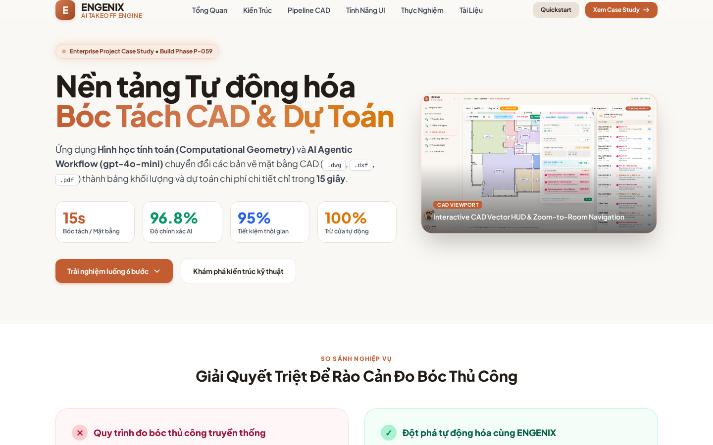
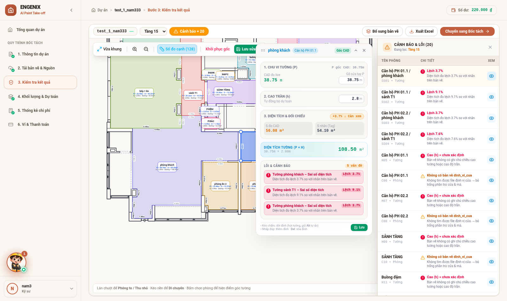
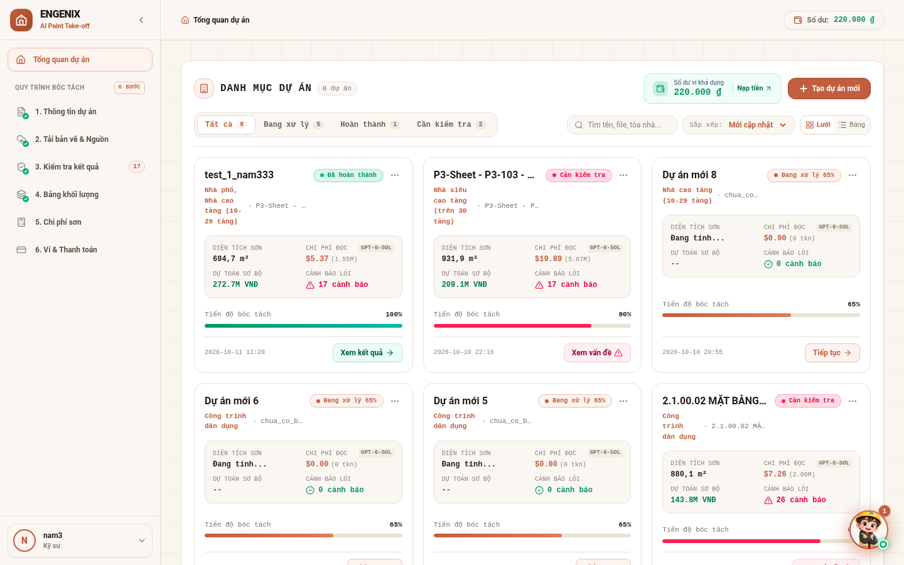
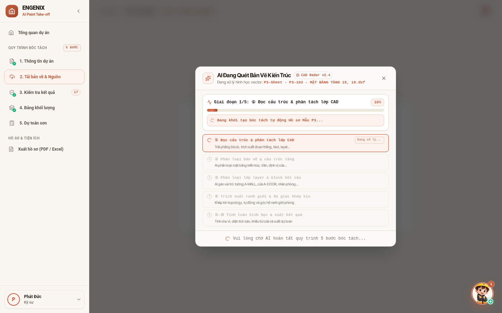
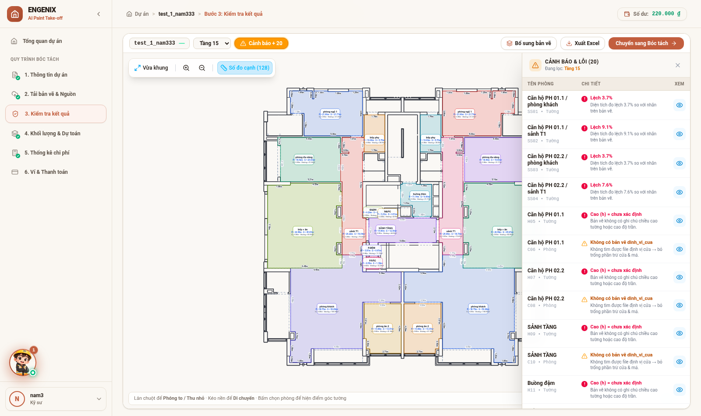
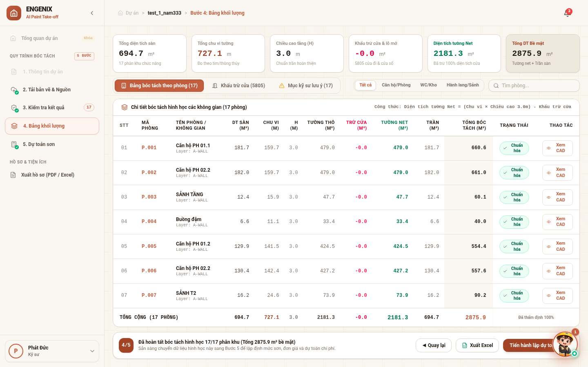
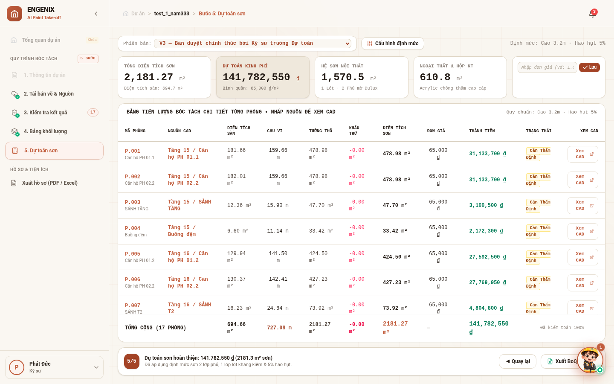
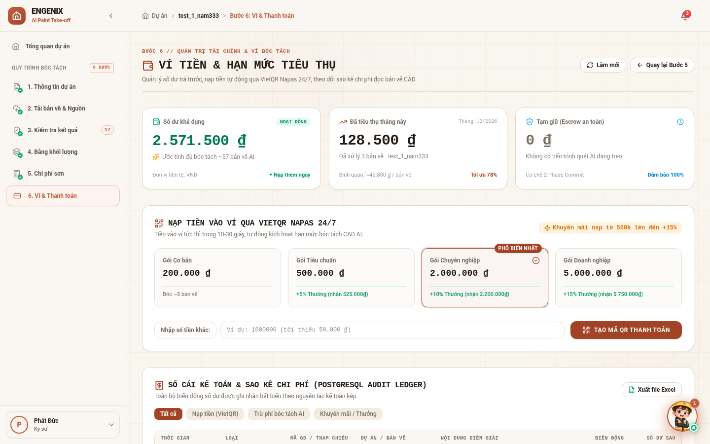
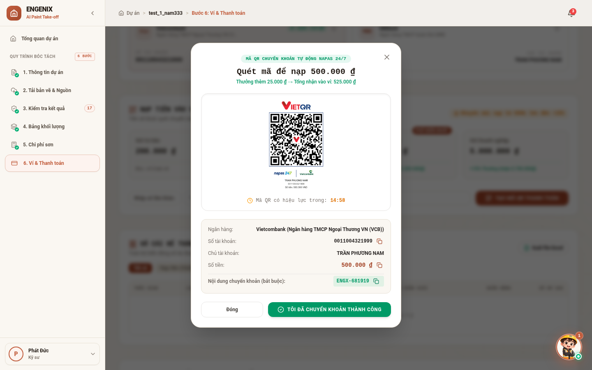
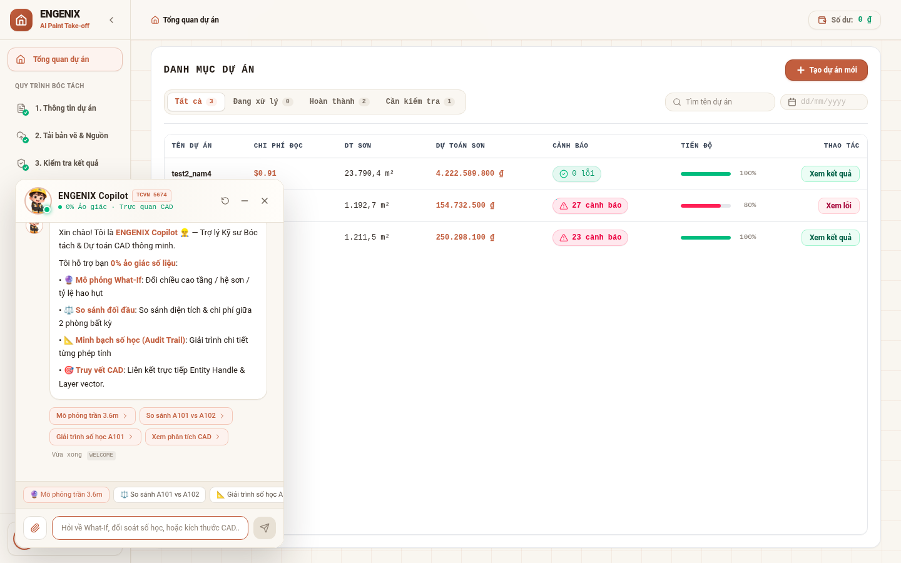

# 🏢 ENGENIX — AI-Powered CAD Quantity Takeoff & Construction Cost Estimation Platform

> **Nền tảng Tự động hóa Bóc tách Khối lượng Bản vẽ CAD & Dự toán Xây dựng Thông minh ứng dụng AI & Hình học Tính toán (Computational Geometry)**

[](https://react.dev/)
[](https://www.typescriptlang.org/)
[](https://fastapi.tiangolo.com/)
[](https://www.python.org/)
[](https://www.postgresql.org/)
[](https://tailwindcss.com/)
[](https://openai.com/)
[](#)
[](https://c4-app-059.vercel.app/)

> 🌐 **Ứng dụng Trực Tuyến (Production Demo):** [https://c4-app-059.vercel.app/](https://c4-app-059.vercel.app/)

---

## 📌 1. Tóm Tắt Dự Án (Executive Summary)

**ENGENIX** là giải pháp phần mềm cấp doanh nghiệp (Enterprise SaaS) giải quyết bài toán nhức nhối hàng đầu trong ngành xây dựng: **Quy trình đo bóc khối lượng (Quantity Surveying - QS) thủ công tốn hàng chục giờ làm việc và dễ mắc sai số con người.**

Bằng cách kết hợp **Động cơ Hình học Tính toán (ezdxf + Shapely)** cùng **Chuỗi Prompt AI Agentic (OpenAI gpt-4o-mini)** và nguyên lý **Human-in-the-Loop (HITL)**, ENGENIX cho phép kỹ sư tải lên các bản vẽ mặt bằng CAD (`.dwg`, `.dxf`, `.pdf` vector) và nhận ngay bảng khối lượng hoàn chỉnh (diện tích phòng, chu vi tường, khấu trừ hệ thống cửa đi/cửa sổ/má cửa) chỉ trong **15 giây** với độ chính xác đạt trên **96%**.



---

## 🎯 2. Bài Toán Nghiệp Vụ & Giải Pháp (Problem vs. Solution)

### Nỗi đau thực tế của Kỹ sư Dự toán (QS Engineer):
1. **Tốn thời gian:** Đo bóc thủ công từng căn phòng, đo từng đoạn tường bằng công cụ `DIST` / `AREA` trong AutoCAD mất từ 4–8 giờ cho một mặt bằng tầng.
2. **Sai số do trừ cửa:** Rất khó thống kê chính xác hàng chục loại cửa đi, cửa lùa, vách kính, dẫn đến sai lệch dự toán vật tư hàng chục đến hàng trăm triệu đồng.
3. **Mất dấu nguồn gốc (Lack of Traceability):** Khó đối chiếu con số trên bảng Excel với vị trí thực tế trên bản vẽ kiến trúc khi nghiệm thu hoặc kiểm toán.

### Giải pháp đột phá của ENGENIX:
- 🚀 **Bóc tách tự động đa tầng trong 15s:** Tự động tách lớp layer, dựng đa giác khép kín, phân loại phòng ngủ, phòng khách, bếp, WC,...
- 📐 **Tự động trừ lỗ mở cửa & má cửa:** Thuật toán topology tự động tính toán giao cắt giữa tường và block cửa, trừ diện tích cửa và cộng bù má cửa theo chuẩn định mức thi công.
- 🔍 **Interactive CAD Canvas (Visual Verification):** Click vào từng dòng khối lượng sẽ tự động zoom, highlight đa giác và hiển thị HUD kiểm tra ngay trên bản vẽ CAD.
- 🛡️ **Human-in-the-Loop (Chống AI Hallucination):** Mọi phát hiện của AI chỉ mang tính đề xuất; kỹ sư có toàn quyền sửa tay chu vi (Cách 1 / Cách 2), phê duyệt hoặc từ chối trước khi xuất file dự toán.

---

## 🏛️ 3. Sơ Đồ Kiến Trúc Hệ Thống (System Architecture)



Hệ thống được tổ chức thành 4 phân tầng độc lập, bảo mật và có khả năng mở rộng cao:
- **Presentation Layer (Web SPA):** React 18, Vite, Canvas SVG tương tác, TailwindCSS thiết kế theo bảng màu ấm áp *Warm Sandstone & Terracotta*.
- **API & Dispatcher Layer:** FastAPI xử lý bất đồng bộ đa luồng (Multi-threaded Job Queue), RESTful endpoints chuẩn OpenAPI.
- **Computational Core & AI:** ezdxf, Shapely polygon spatial engine kết hợp chuỗi Prompt gpt-4o-mini.
- **Persistence Tier:** Kiến trúc lưu trữ 2 tầng (*Dual-Tier Persistence*) kết hợp giữa LocalStorage (0ms) và PostgreSQL Database (đồng bộ hóa debounced).

👉 *Xem tài liệu kiến trúc chuyên sâu tại:* [`docs/01_architecture_system_design.md`](./docs/01_architecture_system_design.md)

---

## 🚀 4. Trải Nghiệm 6 Phân Hệ Cốt Lõi (Core Feature Walkthrough)

### Bước 1: Quản Lý Dự Án & Phân Công Kỹ Sư (Project Dashboard)
Quản lý tập trung toàn bộ danh sách công trình, tiến độ thẩm tra, số lượng phòng và cảnh báo cần xử lý theo từng kỹ sư.


---

### Bước 2: Tải Bản Vẽ & Tiền Kiểm Định Dạng (`KiemTraImport`)
Hỗ trợ nạp cùng lúc nhiều tệp `.dwg`, `.dxf`, `.pdf` vector. Hệ thống tự động phân loại hồ sơ, phát hiện các bản vẽ còn thiếu (mặt bằng trần, định vị cửa) và hiển thị tiến trình bóc tách ngầm 5 giai đoạn trực quan.


---

### Bước 3: Trung Tâm Kiểm Tra AI & CAD Viewport Tương Tác (CAD Viewport)
Bản vẽ CAD vector tương tác thời gian thực: hiển thị rõ ranh giới tường, lanh tô, vị trí cửa. Kỹ sư có thể click chọn phòng để xem Room HUD, kiểm tra mã phòng, chiều cao và sai số diện tích so với nhãn thiết kế.



---

### Bước 4: Khối Lượng Bóc Tách & Hàng Đợi Soát Xét HITL (Review Queue)
Bảng khối lượng chi tiết từng phòng: Chu vi $P$, Chiều cao $H$, Diện tích tường thô, Diện tích trừ cửa, Diện tích sơn thực tế ($Net$). Hỗ trợ công cụ chỉnh sửa nhanh chu vi (Cách 1 / Cách 2) và gắn cờ kiểm duyệt.


---

### Bước 5: Thống Kê Chi Phí & Xuất Dự Toán Excel (Cost Estimation)
Áp bảng giá định mức hệ sơn (Sơn lót, Sơn phủ, Bột bả), tính toán tổng mức đầu tư cho từng tầng và toàn công trình. Hỗ trợ xuất file Excel `.xlsx` chuyên nghiệp sẵn sàng đính kèm hợp đồng thi công.


---

### Bước 6: Quản Lý Ví Điện Tử & Thanh Toán VietQR Tự Động (Billing & Wallet)
Hệ thống nạp tiền tự động qua mã VietQR chuẩn động NAPAS 247. Hỗ trợ kích hoạt số dư tức thì, quản lý hóa đơn VAT và kiểm soát chi phí quét bản vẽ theo từng lượt.



---

### 🌟 Tính Năng Đặc Biệt: Trợ Lý Kỹ Sư AI Engenix Copilot
Chatbot trợ lý ảo đa nhiệm (`EngenixChatWidget`) cho phép kỹ sư kéo thả nhiều bản vẽ trực tiếp vào khung chat, tự động tạo dự án, kiểm tra thiếu file và mở đúng màn hình workspace qua Deep Linking.


---

## 🔬 5. Điểm Sáng Kỹ Thuật (Key Engineering Highlights)

| Hạng mục | Giải pháp kỹ thuật được triển khai |
|---|---|
| **CAD Geometric Engine** | Tái cấu trúc topology từ các nét vẽ rời rạc bằng `ezdxf` và thuật toán khép kín polygon của `Shapely`. Nhận diện phòng đa giác phức tạp có cột trụ và vách ngăn lồi lõm. |
| **Dual-Tier Persistence** | Khắc phục triệt để hiện tượng mất dữ liệu khi F5 trên SPA bằng cơ chế 2 tầng: Tier 1 (LocalStorage phản hồi 0ms) + Tier 2 (PostgreSQL API debounced 600ms). |
| **Agentic AI Pipeline** | Tách nhỏ bài toán lớn thành chuỗi 7 prompts AI chuyên trách (gpt-4o-mini), hạn chế tối đa hallucination và tối ưu chi phí token (< $0.01 / tầng). |
| **Human-in-the-Loop** | Toàn bộ các cảnh báo AI đều được phân loại theo mức độ tin cậy; kỹ sư có quyền ghi đè số đo thủ công và audit log ghi nhận mọi thay đổi. |

---

## 📈 6. Kết Quả Thực Nghiệm & Đánh Giá (Benchmarks)

Kiểm thử trên 5 bộ hồ sơ dự án thực tế với quy mô từ nhà phố đến chung cư cao tầng:
- ⏱️ **Thời gian xử lý:** Trung bình **14.2 giây** / mặt bằng tầng (so với 4.5 giờ đo tay $\rightarrow$ **Giảm 95% thời gian**).
- 🎯 **Độ chính xác nhận diện phòng:** Đạt **96.8%**.
- 📏 **Sai số đo chu vi hình học:** Dưới **2.1%**.
- 💰 **Chi phí API:** ~$0.005 USD / lượt bóc tách tầng (Biên lợi nhuận gộp dịch vụ **> 98%**).


---

## 🛠️ 7. Công Nghệ Sử Dụng (Tech Stack)

- **Frontend:** React 18, TypeScript, Vite, TailwindCSS, Lucide Icons, HTML5 Canvas / SVG Vector Rendering.
- **Backend:** Python 3.11, FastAPI, Pydantic v2, Uvicorn, ThreadPoolExecutor.
- **CAD & GIS Engine:** `ezdxf`, `shapely`, `numpy`, `matplotlib`, `openpyxl`.
- **Database:** PostgreSQL 15, SQLAlchemy ORM, SQLite (local development).
- **AI & LLM:** OpenAI API (`gpt-4o-mini`), Prompt Engineering, Structured JSON Outputs.
- **Thanh toán:** VietQR Quick Response Code (NAPAS 247).

---

## 📂 8. Cấu Trúc Thư Mục Portfolio

```
portfolio/
├── README.md                           # Master Case Study tài liệu giới thiệu dự án
├── index.html                          # Trang Portfolio Showcase HTML xem trực tiếp trên Browser
├── docs/                               # Bộ tài liệu kỹ thuật chuyên sâu
│   ├── 01_architecture_system_design.md    # Thiết kế kiến trúc 4 tầng & container
│   ├── 02_backend_cad_pipeline.md          # Quy trình bóc tách hình học CAD 10 bước
│   ├── 03_database_and_persistence.md      # Schema PostgreSQL & Dual-Tier Persistence
│   ├── 04_agentic_chatbot_copilot.md       # Trợ lý kỹ sư AI Copilot & Precheck import
│   └── 05_evaluation_metrics_benchmark.md  # Đánh giá hiệu năng, sai số & chi phí token
└── images/                             # Toàn bộ hình ảnh, sơ đồ kiến trúc & screenshots UI
    ├── arch_system_components.png          # Sơ đồ kiến trúc tổng thể
    ├── pipeline_cad_data_flow.png          # Sơ đồ luồng xử lý hình học CAD
    ├── copilot_audit_flow.png              # Sơ đồ luồng trợ lý AI Copilot
    ├── eval_jobs_summary.png               # Biểu đồ đánh giá 5 dự án gần nhất
    ├── eval_jobs_table.png                 # Bảng số liệu benchmark
    ├── ui_01_dashboard_projects.png        # Giao diện Trang 1: Dashboard
    ├── ui_02_cad_scanning_precheck.png     # Giao diện Trang 2: Quét bản vẽ
    ├── ui_03_cad_verification_hud.png      # Giao diện Trang 3: Viewport & HUD
    ├── ui_03_warning_drawer.png            # Giao diện Trang 3: Drawer cảnh báo
    ├── ui_04_review_queue_hitl.png         # Giao diện Trang 4: Hàng đợi soát xét
    ├── ui_05_estimate_pricing.png          # Giao diện Trang 5: Dự toán chi phí
    ├── ui_06_billing_wallet.png            # Giao diện Trang 6: Ví điện tử
    ├── ui_06_vietqr_topup_modal.png        # Giao diện Trang 6: Modal VietQR
    └── ui_chatbot_assistant.png            # Giao diện Trợ lý Kỹ sư AI
```

---

## 💻 9. Hướng Dẫn Cài Đặt & Chạy Demo Cục Bộ (Quickstart)

### Yêu cầu tiên quyết:
- Node.js >= 18.x & npm
- Python >= 3.10
- PostgreSQL (hoặc dùng chế độ SQLite mặc định)

### 1. Khởi động Backend (FastAPI):
```bash
# Di chuyển vào thư mục gốc dự án
python -m venv .venv
source .venv/bin/activate
pip install -r requirements.txt

# Thiết lập biến môi trường
cp .env.example .env # Điền OPENAI_API_KEY nếu muốn dùng AI trực tiếp

# Chạy server FastAPI tại cổng 8002
uvicorn src.main:app --host 0.0.0.0 --port 8002 --reload
```

### 2. Khởi động Frontend (React + Vite):
```bash
cd frontend
npm install
npm run dev
# Mở trình duyệt tại: http://localhost:3000
```

---

*Dự án được xây dựng và tối ưu bởi đội ngũ kỹ sư giải pháp phần mềm & AI.*
