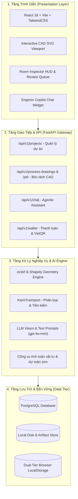

# 🏗️ Sơ Đồ & Thiết Kế Kiến Trúc Hệ Thống (System Architecture Design)

## 1. Giới thiệu tổng quan

**ENGENIX** là nền tảng điện toán đám mây hỗ trợ kỹ sư bóc tách khối lượng (Quantity Surveyor - QS) và nhà thầu xây dựng tự động hóa quy trình đo bóc từ bản vẽ CAD (DXF, DWG, PDF vector) sang bảng khối lượng và dự toán chi phí với sự hỗ trợ của Trí tuệ Nhân tạo (AI).

Hệ thống được thiết kế theo nguyên lý **Human-in-the-Loop (HITL)**: AI đóng vai trò trợ lý đề xuất và tính toán hình học phức tạp, trong khi kỹ sư con người giữ toàn quyền kiểm soát, soát xét và phê duyệt kết quả cuối cùng.

---

## 2. Kiến trúc 4 tầng (Layered Architecture)

### 2.1 Tầng Trình Diễn (Presentation Layer)
- **Công nghệ:** React 18, Vite, TypeScript, TailwindCSS (Palette màu: Warm Sandstone & Terracotta).
- **Interactive CAD Canvas:** Hiển thị vector tường, cửa, lanh tô, nhãn phòng đa tầng với khả năng pan, zoom, click-to-highlight và room inspector HUD.
- **Review Queue (HITL):** Giao diện bảng khối lượng tương tác hỗ trợ gắn cờ, chấp nhận, từ chối, hoặc ghi đè chu vi bằng tay (Cách 1 / Cách 2).
- **Floating Copilot Widget:** Trợ lý ảo AI hoạt động dạng đa nhiệm thu nhỏ, cho phép kéo thả nhiều file bản vẽ và khởi chạy bóc tách ngầm.

### 2.2 Tầng API & Điều Phối (API Gateway)
- **Công nghệ:** FastAPI (Python 3.11), Pydantic v2, Uvicorn.
- **Xử lý bất đồng bộ:** Tách luồng upload file và bóc tách thành các background jobs độc lập qua `threading.Thread` và `ThreadPoolExecutor`, trả về `jobId` ngay lập tức để client poll trạng thái.
- **Cơ chế Event Bridge:** Bắt sự kiện giữa viewport CAD và bảng khối lượng qua custom DOM events (`wallet_balance_updated`, `cad_room_selected`).

### 2.3 Tầng Xử Lý Hình Học CAD & AI (Core Engine)
- **Phân tích hình học:** `ezdxf` bóc tách từng layer, block attribute; `Shapely` khép kín ranh giới đa giác phòng, tính diện tích thực và chu vi viền.
- **AI Agentic Layer:** Chuỗi prompts chuyên biệt gpt-4o-mini thực hiện phân loại bản vẽ kiến trúc, nhận diện vai trò layer (`tuong`, `cua`, `lanh_to`, `nhan_phong`), trích xuất cao độ trần và quy chuẩn mã hiệu cửa.
- **Tính toán dự toán:** Trừ lỗ mở cửa đi, cửa sổ, má cửa và vách kính theo chuẩn định mức thi công Việt Nam.

### 2.4 Tầng Lưu Trữ (Data & Persistence Tier)
- **PostgreSQL:** Lưu trữ thông tin dự án, kỹ sư, danh sách phòng bóc tách, bảng giá sơn và nhật ký kiểm toán (Audit Trail).
- **Dual-Tier Client Caching:** Cơ chế lưu trữ 2 tầng kết hợp giữa LocalStorage (0ms latency, bảo toàn trạng thái khi F5) và PostgreSQL Sync (debounced 600ms).

---

## 3. Kiến trúc Container & Micro-services

| Thành phần | Container / Tiến trình | Port | Trách nhiệm chính |
|---|---|---|---|
| **Frontend Web** | Node.js / Nginx | `3000` | Giao diện tương tác người dùng, canvas vector |
| **Backend API** | FastAPI / Uvicorn | `8002` | API router, xử lý job, xác thực, thanh toán |
| **Database** | PostgreSQL 15 | `5432` | Lưu trữ quan hệ ACID, bảo mật dữ liệu |
| **Vector & File Store** | Filesystem / S3 compatible | Local | Lưu trữ file DWG/DXF gốc, ảnh PNG mặt bằng, Excel xuất xưởng |
