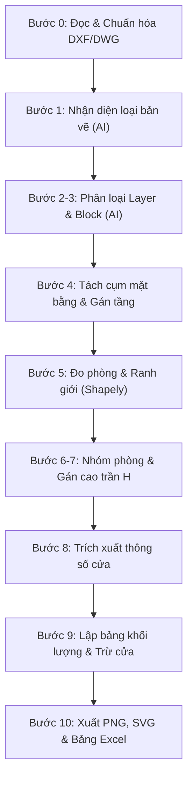

# ⚙️ Quy Trình Bóc Tách Hình Học CAD 10 Bước (10-Step CAD Pipeline)

## 1. Tổng quan quy trình

Pipeline bóc tách CAD của **ENGENIX** là sự kết hợp độc đáo giữa **Hình học tính toán thuần túy (Computational Geometry)** và **Trí tuệ nhân tạo (LLM Agentic Prompts)**. Hệ thống giải quyết bài toán cốt lõi: biến các nét vẽ vector rời rạc (Line, Polyline, Arc, Text, Block) trong file CAD thành các thực thể phòng (Rooms) có ý nghĩa nghiệp vụ và số đo chính xác.

---

## 2. Chi tiết 10 Bước Xử Lý Cốt Lõi (Step-by-Step)

### Bước 0: Đọc & Chuẩn hóa DXF/DWG (`doc_ban_ve`)
- Hỗ trợ file đầu vào: `.dxf`, `.dwg` (chuyển đổi qua ODA Converter hoặc LibreCAD ngầm), và `.pdf` vector.
- Dùng `ezdxf` bóc tách từng thực thể hình học, lưu bộ đệm song song tại `.lam_viec/dxf/` để tăng tốc độ xử lý khi quét lại.

### Bước 1: Nhận diện loại bản vẽ (`nhan_dien_ban_ve`)
- Trích xuất các chuỗi Text kích thước lớn, tiêu đề bản vẽ và cấu trúc layer.
- **AI Prompt 01:** Phân loại tự động bản vẽ:
  - Mặt bằng kiến trúc (`mat_bang`)
  - Mặt bằng trần (`tran`)
  - Mặt bằng định vị cửa (`dinh_vi_cua`)
  - Chi tiết cửa / Mặt cắt / Khác.

### Bước 2 & 3: Phân loại Layer và Block họ kết cấu (`phan_loai`)
- Thống kê toàn bộ layer và block của từng bản vẽ.
- **AI Prompt 02 & 03:** Gán nhãn ngữ nghĩa:
  - Layer tường: `tuong`, `A-WALL`, `TUONG_110`, `TUONG_220`
  - Layer lanh tô: `lanh_to`
  - Layer nhãn phòng: `nhan_phong`, `TEXT_PHONG`
  - Block cửa: Phân loại cửa đi 1 cánh, 2 cánh, cửa lùa, cửa sổ, vách kính.

### Bước 4: Tách cụm mặt bằng & Gán tầng (`tim_mat_bang`)
- Gom cụm không gian hình học (Spatial Clustering) để tách riêng các tầng nếu một bản vẽ chứa nhiều mặt bằng.
- **AI Prompt 04:** Nhận diện và gán tầng chính xác (Tầng 1, Tầng 2, Tầng 15, Tầng Mái,...). Khớp mặt bằng trần và mặt bằng định vị cửa vào mặt bằng kiến trúc tương ứng.

### Bước 5: Đo phòng hình học & Ô mở (`do_phong`)
- **Động cơ Shapely Polygon:**
  - Dựng topology tường và lanh tô khép kín.
  - Phân tích đa giác phòng (`Polygon` & `MultiPolygon`).
  - Tự động phát hiện các ô mở (`phan_tich_o_mo`): cửa ra vào, ô thoáng, khoảng thông tầng.
  - Khớp mã hiệu cửa từ bản vẽ định vị vào vị trí thực tế trên tường.

### Bước 6 & 7: Nhóm phòng & Gán cao độ trần (`chon_phong` + `cao_tran`)
- **AI Prompt 05 & 06:**
  - Gom các nhãn phòng trùng lặp (ví dụ: gộp nhãn phụ WC vào nhóm phòng chính).
  - Trích xuất cao độ trần thực tế (ví dụ: `H = 3.3m`, `H = 2.7m` từ bản vẽ trần thạch cao).
  - Kiểm tra sai số (`kiem_bien`): So sánh diện tích hình học đo được và số ghi chú trên bản vẽ. Nếu chênh lệch < 3% thì đánh dấu an toàn, > 3% gắn cờ "Cần kiểm tra" (Needs Review).

### Bước 8: Trích xuất thông số chi tiết cửa (`thong_so_cua`)
- Tổng hợp bảng kích thước cửa: chiều rộng ($W$), chiều cao ($H$), độ dày tường ($T$), má cửa ($Jamb$).
- **AI Prompt 07:** Chuẩn hóa kích thước hình học từ mã hiệu (`D1`, `D2`, `S1`, `V1`...).

### Bước 9: Lập bảng khối lượng sơn tường (`lap_bang`)
Áp dụng công thức chuẩn kỹ thuật QS:
$$\text{Diện tích tường tổng (Gross)} = \text{Chu vi (P)} \times \text{Chiều cao (H)} \times \text{Số tầng}$$
$$\text{Trừ cửa} = \sum (\text{Số lượng} \times \text{Rộng} \times \text{Cao})$$
$$\text{Cộng má cửa} = \sum (\text{Chiều dài viền} \times \text{Rộng má})$$
$$\text{Diện tích sơn thực tế (Net)} = \text{Gross} - \text{Trừ cửa} + \text{Má cửa} - \text{Ô thoáng}$$

### Bước 10: Xuất kết quả đa phương thức (`xuat`)
- **Hình ảnh PNG:** Vẽ mặt bằng highlight từng phòng bằng màu sắc trực quan, ghi chú diện tích và chu vi.
- **Dữ liệu Vector SVG:** Xuất JSON tọa độ tường, cửa, đa giác phục vụ tương tác trên Web CAD Canvas.
- **Excel Dự toán:** Xuất file `.xlsx` đầy đủ bảng tính, công thức động và sheet tổng hợp giá theo tầng.
