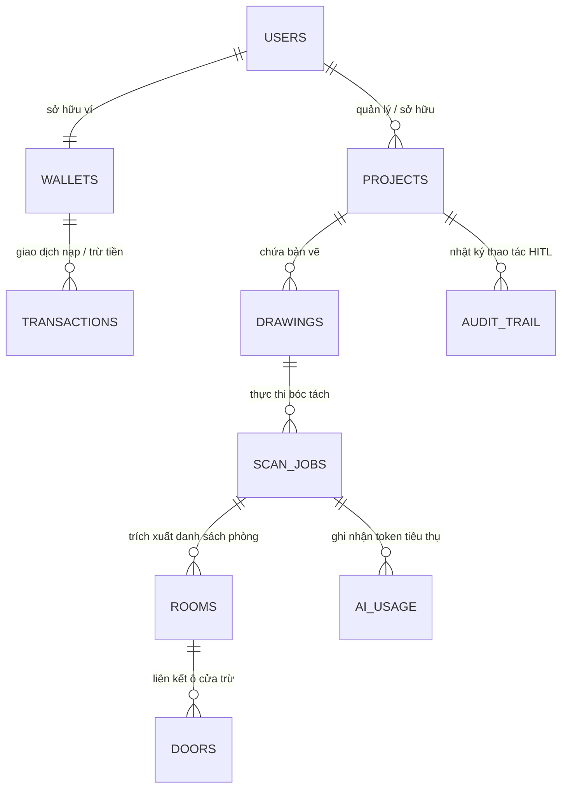
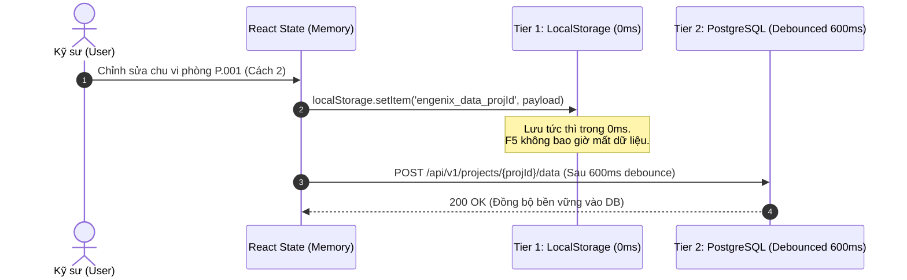

# 💾 Mô Hình Cơ Sở Dữ Liệu & Kiến Trúc Lưu Trữ 2 Tầng (Database & Persistence)

## 1. Sơ đồ Quan hệ Thực thể (ERD)

Hệ thống ENGENIX quản lý dữ liệu theo mô hình quan hệ chặt chẽ, tối ưu cho cả nghiệp vụ dự toán xây dựng lẫn theo dõi chi phí mô hình AI và số dư ví điện tử.

---

## 2. Chi tiết các bảng dữ liệu cốt lõi (Core Tables)

### 2.1 Bảng `projects` (Dự án bóc tách)
- `id` (VARCHAR PK): Mã định danh dự án (`proj-2026-001`).
- `name` (VARCHAR): Tên công trình / dự án.
- `building` (VARCHAR): Phân loại loại hình công trình (Nhà cao tầng, Biệt thự, Nhà phố,...).
- `status` (VARCHAR): Trạng thái (`Draft`, `Review Required`, `Approved`).
- `total_area` (NUMERIC): Tổng diện tích sơn toàn dự án ($m^2$).
- `total_cost` (BIGINT): Tổng dự toán chi phí sơn (VNĐ).
- `engineer_id` (VARCHAR FK): Kỹ sư phụ trách dự án.

### 2.2 Bảng `rooms` (Thực thể phòng bóc tách)
- `id` (VARCHAR PK): Mã định danh phòng (`room-1`).
- `code` (VARCHAR): Mã hiệu hiển thị (`P.001`, `P.002`).
- `name` (VARCHAR): Tên phòng chuẩn hóa AI (`Phòng khách`, `Phòng ngủ 1`).
- `floor` (VARCHAR): Tầng (`Tầng 15`, `Tầng 16`).
- `floor_area` (NUMERIC): Diện tích sàn ($m^2$).
- `perimeter` (NUMERIC): Chu vi tường ($m$).
- `wall_height` (NUMERIC): Chiều cao tường ($m$).
- `gross_wall_area` (NUMERIC): Diện tích tường trước khi trừ cửa ($m^2$).
- `door_deductions` (NUMERIC): Diện tích lỗ mở cửa bị trừ ($m^2$).
- `net_paint_area` (NUMERIC): Diện tích sơn thực tế ($m^2$).
- `unit_rate` (BIGINT): Đơn giá sơn áp dụng (VNĐ/$m^2$).
- `total_cost` (BIGINT): Thành tiền dự toán của phòng.
- `confidence` (NUMERIC): Điểm tin cậy của AI (85% - 98%).
- `status` (VARCHAR): Trạng thái kiểm duyệt HITL (`Detected`, `Needs Review`, `Confirmed`, `Corrected`).

### 2.3 Bảng `wallets` & `transactions` (Ví điện tử & VietQR)
- Hỗ trợ thanh toán bóc tách theo hạn mức nạp tối thiểu (10.000 ₫ hoặc 50.000 ₫).
- Tích hợp chuẩn VietQR động với mã chuyển khoản `ENGENIX <USER_ID>` giúp kích hoạt số dư tự động qua Webhook / Polling.

---

## 3. Kiến trúc Lưu trữ 2 Tầng (Dual-Tier Persistence)

Một trong những thách thức kỹ thuật lớn nhất trên ứng dụng Single Page Application (SPA) xử lý CAD là: **Người dùng có thể tải lại trang (F5) bất kỳ lúc nào, hoặc chỉnh sửa chu vi thủ công trên hàng chục phòng.**

ENGENIX triển khai kiến trúc lưu trữ 2 tầng độc quyền:

### Ưu điểm vượt trội của cơ chế:
1. **0ms Latency:** Phản hồi ngay lập tức trên giao diện, không bị khựng (freeze) khi kỹ sư nhập số liệu liên tục.
2. **Kháng Crash:** Khi mất mạng hoặc F5, dữ liệu được khôi phục 100% trong 0ms từ Tier 1 trước khi kiểm tra Tier 2.
3. **Chống Race-Condition:** Áp dụng cờ `isRestoringRef` và `loadedProjectIdRef` đảm bảo việc chuyển đổi giữa các dự án không ghi đè dữ liệu cũ vào dự án mới.
